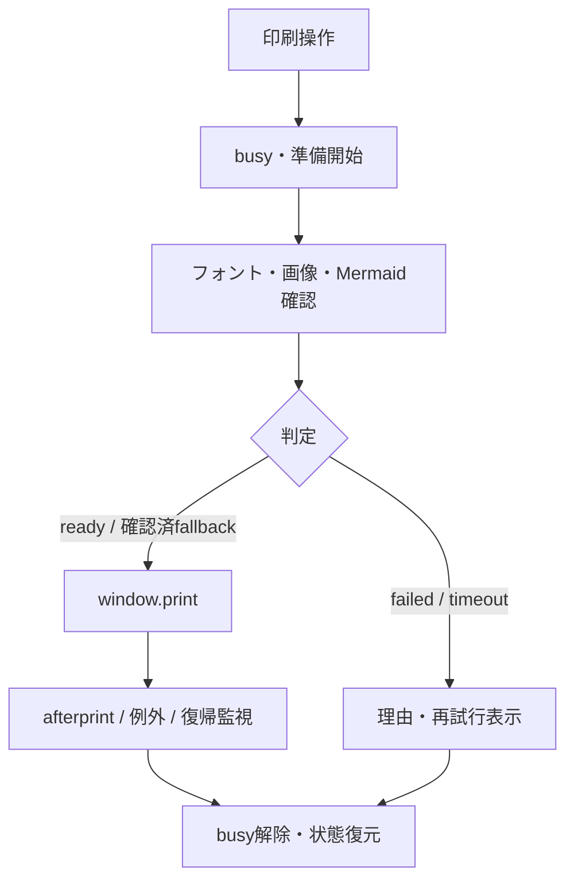

# MKB PDF出力品質改善 画面・処理設計書 v0.1
2026-10-29 / 対応: [追加要件定義書](./pdf-print-quality-phase1-requirements-v0.1.md) / レビュー用

## 画面設計
既存More actionsの `Print / PDF` と `Export Styled HTML / PDF…` を維持。簡易印刷は準備中のdisabled表示を維持し、失敗時のみ対象・理由・再試行を表示する。Styled ExportのColor/Design/Text size/Show tags、画像対応付け、HTML出力、スナップショット固定は変更しない。390pxでもメッセージと操作が画面内に収まること。印刷物にはエラーUIを出さない。

## 準備結果モデル（概念型）
```ts
type PrintReadiness =
  | { status: 'ready' }
  | { status: 'fallback'; issues: PrintIssue[] }
  | { status: 'failed'; issues: PrintIssue[] }
  | { status: 'timeout'; issues: PrintIssue[] };
type PrintIssue = { kind: 'font'|'image'|'mermaid'|'other'; target?: string; reason: string };
```

## 状態遷移

二重クリックを防止。各試行に識別子を付け、古い非同期結果を破棄。ノート切替時に旧DOMを印刷しない。画像はnaturalWidth/decodeも確認。Mermaidのfallbackは代替コード等が実際に印刷可能な場合のみ許可。afterprint未発火でもbusyを解除するが保存完了は判定しない。

## CSS設計
`src/App.css` と `src/lib/styledExport/document.css` の既存規則を比較し、日本語改行、見出し孤立、長大要素の処理など意味の共通部分のみ再利用。色・余白・デザインは各経路固有。一律 `break-inside: avoid` による欠落を防ぐ。`@page` と印刷対象UI非表示が競合しないことを検証する。

## 変更候補
- `src/App.tsx`: readiness、エラー表示、cleanup、retry
- `src/App.css`: 簡易印刷の禁則・改ページ
- `src/lib/styledExport/document.css`: Styled印刷の禁則・改ページ
- `src/components/StyledExportView.tsx`: 必要な場合のみ既存判定との整合調整
- テスト: unit、Playwright E2E、固定Markdown fixtures
実際の変更ファイルはCodexが現行mainを確認して確定する。

## テストデータ
日本語句読点・括弧・長URL、2ページ超のコード/表、巨大Mermaid、画像失敗、フォント待機超過、空本文、未保存draft、オフライン、印刷キャンセル。Chromiumで自動検証し、Safari・iOS・Androidの手動検証を別ゲートにする。PDFの文字欠落、ページ数、可読性、UI混入を検査する。

## Phase 1 完了条件
要件ID→テストIDの対応表、変更前後の比較結果、ブラウザ別既知制約、未検証事項をPRに記載。CI失敗を黙認しない。
